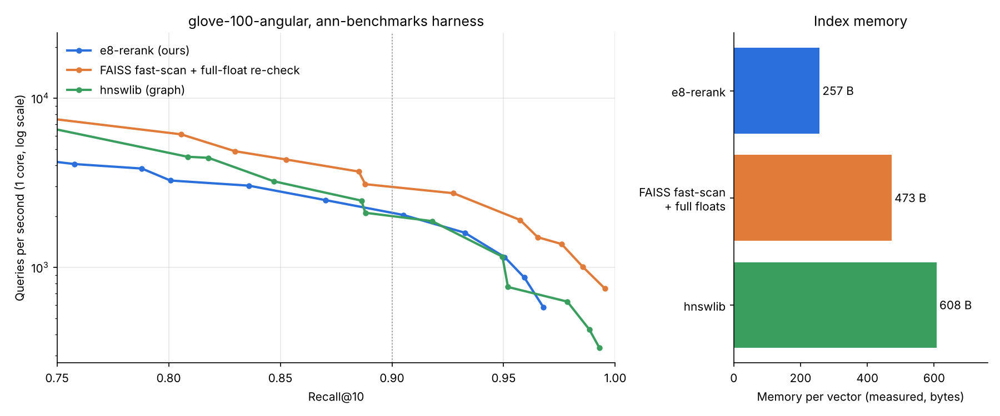

# e8-rerank

**The most accurate vector re-check codes we know of at tight memory budgets
(about 50–100 bytes per vector), built from the E8 lattice. No training.**

Vector search engines usually work in two passes. A fast first pass finds a
few hundred rough candidates, and a re-check pass re-scores them using a
more accurate compressed copy of each vector. This repository replaces the
usual re-check copy (FAISS product quantization, residual/additive
quantizers or 8-bit scalar codes) with codes built from the **E8 lattice**,
the densest sphere packing in 8 dimensions.

E8 codes need **no codebook training**. Only one scale number per level is
fitted. Combined with score-aware rounding (the anisotropic loss from
ScaNN), they gave higher recall than every FAISS re-check code we tested at
the same memory, on two datasets.

## When to use it

| Your situation | Use |
|---|---|
| Memory is tight: ~50–100 bytes per vector for the re-check copy | **e8-rerank**: 2–6 recall points above FAISS PQ/additive codes at the same size |
| Need a graph index's speed with a third of its memory | **e8-rerank**: matches hnswlib from 90% recall up |
| Memory is plentiful (~130+ bytes per vector) and raw speed matters most | FAISS SQ8 or full-float re-check: simpler and faster |

Raw speed is not where e8-rerank wins. Decoding an E8 code needs a small
table lookup for every 8 numbers, while FAISS's 8-bit and float re-checks
stream plain numbers. Above ~130 bytes per vector, FAISS SQ8 matches or
beats E8.

## Results

### Verification race (exact re-scoring of the same candidates)

Every method re-scores the **same** candidates: the top 300 from a FAISS
`IVF4096,PQ{d/2}x4fs` fast-scan first pass, searching 256 of 4096 buckets.
The numbers are recall@10. Memory is the re-check code per vector, plus 2
bytes for the bucket id on the E8 rows.

| Re-check code | GloVe-100, ~50 B | GloVe-100, ~75 B | fastText-300, ~150 B | fastText-300, ~225 B |
|---|---|---|---|---|
| **E8, score-aware** (no training) | **0.858** (54 B) | **0.915** (80 B) | **0.924** (154 B) | **0.957** (230 B) |
| FAISS PQ, score-aware (trained, 8/12-bit) | 0.839 | 0.913 | 0.904 | 0.950 |
| FAISS PRQ (additive) | 0.810 | 0.904 | 0.866 | 0.942 |
| FAISS RQ (additive) | 0.811 | – | – | – |
| FAISS LSQ (additive, PLSQ) | 0.741 | 0.808 | – | – |
| FAISS PQ (plain) | 0.797 | 0.895 | 0.848 | 0.930 |
| FAISS SQ6 | – | 0.886 | – | 0.918 |
| FAISS SQ8 | 0.928 at 100 B | | 0.960 at 300 B | |

- **Small memory:** E8 leads the strongest FAISS code by about 2 recall
  points on both datasets. That rival is PQ given the same score-aware
  rounding.
- **Larger memory:** a tie. E8 is 0.2 to 0.7 points ahead but uses 5 more
  bytes per vector. The score-aware 12-bit PQ took 25 minutes (GloVe) and
  66 minutes (fastText) to train and encode.
- **Bigger lattices did not help.** The Barnes–Wall 16 lattice and an
  8-state trellis code reduce error by only ~0.1–0.2 dB, and their recall
  was the same or worse than plain E8.

Raw outputs: [`results/`](results/).

Datasets:
- **GloVe-Twitter-100:** 1,183,514 vectors. It's the source of
  ann-benchmarks' `glove-100-angular`.
- **fastText wiki-news-300:** 989,999 vectors.

Both use 10,000 held-out queries (2,000 used for timing), unit-normalised,
inner product.

### This package, end to end (`benchmarks/glove.py`)

Same first pass (35.8 bytes/vector), 300 candidates, 2,000 queries. QPS is
single-thread queries per second on a 4-vCPU cloud VM (best of 3 runs). Treat
differences under ~10% as noise.

| Re-check code | Re-check bytes | Recall @ 64 buckets | QPS | Recall @ 256 buckets | QPS |
|---|---|---|---|---|---|
| *first pass alone, 300 candidates* | – | – | 4,741 | – | 3,419 |
| **E8 ×2, score-aware (C++ kernel)** | 54 | **0.797** | 4,863 | **0.859** | 2,832 |
| FAISS PQ 8-bit (`IndexRefine`) | 50 | 0.744 | 5,385 | 0.798 | 2,768 |
| **E8 ×3, score-aware (C++ kernel)** | 80 | 0.839 | 4,774 | 0.911 | 2,695 |
| FAISS SQ8 (`IndexRefine`) | 100 | 0.847 | 4,228 | 0.924 | 2,563 |
| E8 ×3, numba fallback | 80 | 0.839 | 2,949 | 0.911 | 2,182 |

- **Speed:** with the C++ kernel, the E8 re-check costs about as much as
  FAISS's own refine step. Almost all search time is spent in the shared
  first pass.
- **Against PQ 8-bit:** same speed, about the same memory, and **+5 to +6
  recall points**.
- **Against SQ8:** same speed, 20% less re-check memory, 0.8 to 1.3 points
  less recall.
- **Recall** reproduces the verification race to within half a point
  (0.859 vs 0.858; 0.911 vs 0.915).
- **Build time:** about 3 minutes for 1.2M vectors on 4 cores (4 levels,
  score-aware, C++). FAISS PQ/SQ8 take seconds.

The C++ kernel stores the 65,536 E8 points as int8 at double size, so the
table is 512 KB and stays in cache. One 8-number E8 block fills exactly one
256-bit SIMD register. If the kernel can't be compiled at install time, the
package falls back to numba automatically. `search(..., k2=50)` turns on a
two-step re-check: all candidates get level 1, and only the best `k2` get
the remaining levels, which is 10–25% faster at nearly the same recall.

### ann-benchmarks harness (glove-100-angular, one query at a time)

The wrapper is in [`integrations/ann-benchmarks/`](integrations/ann-benchmarks/).
It was run with ann-benchmarks' own harness (`run.py --local`, one CPU core,
2 runs, best kept). The dataset was rebuilt with ann-benchmarks' own split
from the same GloVe-Twitter vectors, because the ann-benchmarks.com download
is blocked from the machine we used.



| Method | Memory/vector (measured) | QPS at recall ≥ 0.90 | QPS at recall ≥ 0.95 |
|---|---|---|---|
| e8-rerank (E8 ×3) | **257 B**¹ | 2,039 | 1,147 |
| FAISS fast-scan + full-float re-check (`faiss-ivfpqfs`) | 473 B | **2,740** | **1,903** |
| hnswlib (M = 16 / 36) | 608–812 B | 1,875 | 765 |

¹ Measured before build-memory cleanup. The current version measures ~211 B
for 4 levels; the stored index itself is ~142 B.

Honest reading:
- **On ann-benchmarks' main chart (recall vs speed), FAISS's fast-scan
  entry is faster.** It re-checks with the full original floats, which
  costs about 1.8× our memory.
- **We match or beat hnswlib** from 0.90 recall up, using a third to a
  half of its memory.
- e8-rerank's advantage is **memory**, which ann-benchmarks plots only as
  a secondary chart.

## Install and use

```bash
pip install git+https://github.com/Bryan-Disch/e8-rerank
```

```python
import numpy as np
from e8rerank import E8RerankIndex

X = np.load("vectors.npy").astype("float32")   # (n, d); normalise for cosine
index = E8RerankIndex(d=X.shape[1], nlist=4096, levels=2)
index.train(X)
index.add(X)
scores, ids = index.search(queries, k=10, nprobe=64, k1=300)
print(index.bytes_per_vector())
```

Run the tests with `pytest tests`. Reproduce the GloVe table with
`python benchmarks/glove.py`, which downloads ~390 MB on first run.

## How it works

1. **Buckets.** k-means splits the data into `nlist` buckets. Each vector is
   stored relative to its bucket centre (its *residual*) after a fixed
   random rotation that spreads information evenly over the dimensions.
2. **E8 rounding.** The residual is cut into pieces of 8 numbers. Each piece
   is rounded to one of the 65,536 E8 lattice points closest to the origin,
   so it costs 16 bits. The nearest E8 point is found with the
   Conway–Sloane decoder and a lookup table, with no search over a trained
   codebook. Each extra level encodes what the previous levels missed.
3. **Score-aware rounding.** For inner-product search, error *along* a
   vector's own direction changes its scores more than sideways error.
   Each piece is therefore re-rounded among the current E8 point and its
   240 neighbours to minimise
   `|error|² + (η − 1)·(error · x̂)²` with η = 4 (ScaNN's anisotropic loss).
4. **Search.** FAISS fast-scan returns `k1` candidates. Each is re-scored as
   `q·centre + Σ_levels scale · q·E8point`, and the top `k` are returned.

## What is and isn't new

None of the ingredients is new on its own:
- E8 lattice quantization for search (Jégou et al., 2008),
- E8 codebooks with fast decoding (QuIP#, 2024),
- the anisotropic loss (ScaNN, Guo et al., 2020),
- fast-scan PQ (André et al.; FAISS).

As far as we know, the new part is **using E8 codes as the re-check
stage behind a fast-scan first pass, with score-aware rounding over E8's
240 neighbours**. Benchmarked against FAISS's full family of re-check codes
(PQ, residual, LSQ, scalar), this gives better recall at small
memory with no training.

## Caveats

- Two datasets, both word embeddings (100-d and 300-d). Modern
  text-embedding models (768–1536-d) and SIFT-style image features are
  untested.
- The first pass is FAISS's. Only the re-check stage is new, so the gains
  are capped by how good the candidates are.
- Not the fastest. At 90% recall on one core, FAISS's full-float re-check
  is ~1.5× faster (with ~3× the memory) and SQ8 is ~1.1× faster at similar
  memory. Score-aware first-pass codes and more E8 levels did not close
  that gap. The table lookups in decoding are the limit.
- Building is slower than FAISS PQ/SQ8 (minutes vs seconds).
- The C++ kernel is compiled with `-march=native` at install time; wheels
  for other machines would need generic builds.

## Credits

The ideas and the research direction are Bryan Disch's. The implementation
and benchmarks were built with Claude (Anthropic). MIT licence.
